# 肿瘤新抗原预测与单细胞 TCR 免疫组库可复现工作区 (`reproduction/neoantigen_immunogenomics`)

> **工作区定位**：本工作区严格遵循 [01_生信复现项目检索与审计提示词.md](../01_生信复现项目检索与审计提示词.md)（`REPRO-A`～`REPRO-E`）工程规范建设，围绕**肿瘤新抗原预测（体细胞 SNV/Indel + 基因融合）与单细胞转录组 / V(D)J TCR 免疫组库分析**，完成从文献候选检索、7 维红灯审计、独立 Docker 容器构建、全量数据实跑、下游 R 统计可视化到 SOP 与求职 STAR 沉淀的端到端工程闭环。

---

## 1. 目录结构与各文件夹职责说明

```tree
reproduction/neoantigen_immunogenomics/
├── .gitignore                                  # 屏蔽 FASTQ/VCF/参考蛋白组/h5mu/大体积 TSV，放行结果图、摘要表与各级 README.md
├── README.md                                   # 本项目总览、原流程 vs 复现对比、软件清单、排坑记录、结果图全景与复现命令
├── 01_新抗原与肿瘤免疫可复现项目清单.md           # REPRO-A/B：2025–2026 年 8 个已核验双轨可复现候选与选型路线
├── 02_候选项目7维红灯审计.md                     # REPRO-C：候选项目数据、脚本、路径、版本、随机性、算力、严谨性 7 维排雷报告
├── data/
│   ├── README.md                               # 数据总台账（数据集来源、样本规模、HLA 分型、磁盘体量汇总）
│   ├── raw/
│   │   ├── README.md                           # 原始只读输入详解（HCC1395_inputs 全文件清单 + wu2020_3k.h5mu）
│   │   ├── HCC1395/HCC1395_inputs/             # 配对 VCF、phased.vcf.gz、OptiType HLA、STAR-Fusion、AGFusion、GRCh38 蛋白组
│   │   └── scirpy_cache/                       # scirpy 0.26.1 自动拉取缓存 (wu2020_3k.h5mu)
│   └── processed/
│       ├── README.md                           # 清洗后中间对象与全量候选产物字段说明（含 pVACview Shiny 与 TSV 口径解释）
│       ├── smoke_*.tsv                         # 冒烟测试生成的新抗原候选表 (24 条) 与 TCR 克隆性表 (6 例)
│       ├── wu2020_3k_scirpy_processed.h5mu     # Track A 质控+聚类+克隆分析后完整 MuData 对象 (1,845 细胞, 27.75 MB)
│       ├── pvacseq_hcc1395/                    # Track B-1 pVACtools 体细胞新抗原全量输出 (combined / MHC_Class_I / II)
│       └── pvacfuse_hcc1395/                   # Track B-2 pVACtools 基因融合新抗原全量输出 (combined / MHC_Class_I / II)
├── envs/
│   ├── Dockerfile.scirpy                       # Track A 隔离容器定义 (python:3.13-slim + scirpy 0.26.1 / scanpy 1.13.0, 2.17 GB)
│   ├── Dockerfile.pvactools                    # Track B 轻量化离线容器 (python:3.11-slim + pvactools 7.1.5 + MHCnuggets, 5.0 GB)
│   ├── requirements.txt                        # Track A Python 依赖说明（可供独立 .venv 参考）
│   ├── install_packages.R                      # R 包依赖检查与安装脚本（含 ggplot2/data.table/patchwork/ggrepel 等，支持 --dry-run）
│   └── nextflow_docker_check.ps1               # Windows 无可用 WSL2 vm 下 Docker / WSL2 / Java / Nextflow 预检脚本
├── repro_scripts/
│   ├── run_all.py                              # 统一总调度与断言器（支持 --mode smoke / track-a / track-b / downstream / all）
│   ├── 00_smoke_test.py                        # REPRO-D 冒烟 Python 端：构建确定性新抗原/TCR 数据并验证筛选阈值与单调性
│   ├── 00_smoke_test.R                         # REPRO-D 冒烟 R 端：绘制双联质控图并保存 R sessionInfo()
│   ├── 01_scirpy_wu2020_tcr.py                 # Track A 主流程：wu2020_3k GEX 预处理、TCR 链 QC、tcrdist 聚类、多样性与不平衡分析
│   ├── 02_run_pvacseq_hcc1395.ps1              # Track B-1 Docker 一键调度：运行 pvacseq、导出容器版本并调用下游 R 分析
│   ├── 02_pvacseq_hcc1395_analysis.R           # Track B-1 下游 R：Tier 汇总、DAI 计算、Top 30 导出及发表级散点/柱状图
│   ├── 03_run_pvacfuse_hcc1395.ps1             # Track B-2 Docker 一键调度：运行 pvacfuse (AGFusion + STAR-Fusion) 并调用 R 分析
│   └── 03_pvacfuse_hcc1395_analysis.R          # Track B-2 下游 R：融合异构体 Tier 统计、Top 候选导出与读数支持散点图
├── repro_results/
│   ├── environment_versions.tsv                # 宿主机 Python / R / Docker 精确版本快照
│   ├── 00_smoke_verification_summary.tsv       # 冒烟测试定量汇总表 (PASS)
│   ├── 00_smoke_neoantigen_tcr_qc.png          # 冒烟测试双联质控图
│   ├── scirpy_wu2020/                          # Track A 7 张分析图 + 摘要 TSV + CD8_Teff vs CD8_Trm 不平衡表 + 容器版本
│   ├── pvacseq_hcc1395/                        # Track B-1 2 张分析图 + 摘要 TSV + Top 30 候选表 + 容器版本
│   └── pvacfuse_hcc1395/                       # Track B-2 1 张分析图 + 融合摘要 TSV + 融合候选明细表
├── docs/
│   └── REPRO_E_双轨复现SOP与排坑复盘.md         # REPRO-E 技术 SOP：质控阈值依据、5 项实测排坑与真实肿瘤样本接入契约
└── logs/
    ├── smoke_run.log / sessionInfo.txt         # 冒烟全日志与 R 会话信息快照
    ├── 01_scirpy_wu2020.log                    # Track A 容器运行全日志
    ├── 02_pvacseq_hcc1395.log                  # Track B-1 pvacseq 全量预测全日志 (817 行)
    └── 03_pvacfuse_hcc1395.log                 # Track B-2 pvacfuse 全量预测全日志
```

### 各目录功能与 Git 管控约定

| 目录 / 文件 | 核心职责 | Git 跟踪规则 |
|---|---|---|
| `data/raw/` | 存放所有原始只读输入（`HCC1395_inputs/` 与 `scirpy_cache/`），严禁脚本原地覆写 | `*.vcf.gz`/`*.fa.gz`/`*.h5mu`/`*.zip` 全部屏蔽，仅保留 `README.md` 与 `.gitkeep` |
| `data/processed/` | 存放脚本输出的清洗对象（`.h5mu`）与全量新抗原预测文件（最高达 `48.2 MB`）及 `pVACview` Shiny 文件 | 仅跟踪 `smoke_*.tsv`、`README.md` 与 `.gitkeep`，屏蔽 `.h5mu` 与 `pvacseq_hcc1395/`、`pvacfuse_hcc1395/` |
| `envs/` | 声明全部隔离运行时环境（两份独立 Dockerfile、R 检查脚本、预检工具），与宿主机及相邻 `scan-dig` 项目零耦合 | 全量纳入 Git |
| `repro_scripts/` | 全部带中文注释的可执行脚本与总控调度器，采用相对脚本目录自定位，无硬编码绝对路径 | 全量纳入 Git |
| `repro_results/` | 精简后可直接审阅的定量摘要 TSV（100 KB 以内）、软件版本快照及全部 11 张 `.png` 结果图 | 全量纳入 Git，便于直接预览复现成果 |
| `docs/` & `logs/` | 技术 SOP 文档与原始标准输出日志留痕 | `docs/REPRO_E_双轨复现SOP与排坑复盘.md` 纳入 Git；私人资料与 `logs/*.log` 本地留痕 |

---

## 2. 原有流程做了什么 vs 本次复现流程梳理

### 2.1 上游原有流程的核心工作（Upstream Baselines）

1. **Track A 原流程：[`scverse/scirpy`](https://github.com/scverse/scirpy) (`v0.26.1`) 官方教程 `tutorial_3k_tcr.ipynb`**
   - **目标**：演示如何利用 `MuData`（`gex` + `airr`）联合分析单细胞转录组与配对 α/β TCR V(D)J 测序数据。
   - **原始流程内容**：加载 Wu et al. (*Nature*, 2020) 3,000 细胞泛癌种（肺、结直肠、子宫内膜、肾癌肿瘤/癌旁/外周血）子集 → Scanpy 常规降维聚类 → `chain_qc` 检测多链/孤立链并过滤 → 定义核苷酸全同克隆型与氨基酸 `tcrdist` 相似簇 → 计算克隆扩增、香农熵多样性、样本组库重叠（Jaccard）、克隆簇转录组聚集模块度（modularity）、`CD8_Teff` vs `CD8_Trm` 克隆不平衡检验，以及通过 `ir.datasets.iggytop()` 在线检索公共抗原特异性数据库匹配。
2. **Track B 原流程：[`griffithlab/pVACtools`](https://github.com/griffithlab/pVACtools) (`v7.1.5`) 官方标准流程（含 `HCC1395_inputs.zip`）**
   - **目标**：提供临床级体细胞突变及结构融合新抗原的一站式预测、顺式定相校正与交互式筛选。
   - **原始流程内容**：输入已由 VEP 注释且写入 RNA 表达/等位基因深度信息的 VCF、`phased.vcf.gz`（解决邻近胚系/共突变导致的假肽问题）、OptiType HLA-I 分型、以及 STAR-Fusion + AGFusion 融合预测；原官方 Docker Hub 镜像（压缩包达 `9.02 GB`）默认捆绑 IEDB 及多引擎预测器（NetMHCpan、NetMHCIIpan、MHCflurry、MHCnuggets 等），运行 `pvacseq run`、`pvacfuse run` 后自动生成 R Shiny 审阅工程 **`pVACview`** 供人工复核。
3. **编排参考基准：[`nf-core/epitopeprediction`](https://github.com/nf-core/epitopeprediction) (`v3.2.0`)**
   - 作为行业 Nextflow DSL2 标准化流水线参考（`bcftools` → Ensembl VEP → `pVACtools` / `MHCnuggets` → `MultiQC`），指导本工作区的目录结构、免授权开源预测器选型与资源审计标准。

### 2.2 本次端到端复现流程总览

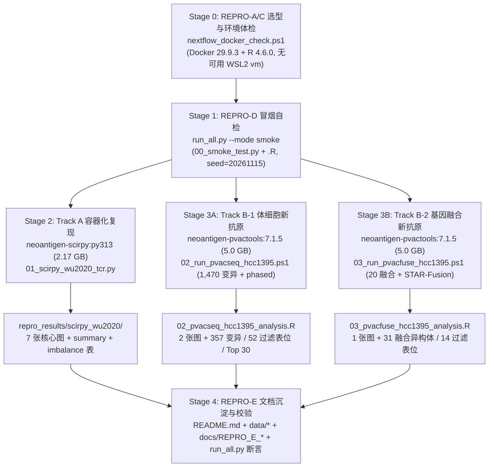

### 2.3 原有流程 vs 本次复现流程逐项对比

| 对比维度 | 上游原有流程 | 本次复现实现与优化 |
|---|---|---|
| **运行平台与调度** | Linux/macOS Conda 或 Jupyter Notebook / Nextflow DSL2 | Windows 无可用 WSL2 `vm` → 构建两套**完全隔离的 Linux Docker 镜像**，以宿主机 `run_all.py` + PowerShell 脚本实现一键自动化串联，对相邻 `scan-dig` 项目零污染 |
| **Track B 容器与引擎** | 官方 `9.02 GB` 大镜像（含 IEDB/NetMHCpan 授权壁垒 + 在线拉取模型） | 自建 `5.0 GB` 轻量化 `neoantigen-pvactools:7.1.5`，采用自带离线权重的 **`MHCnuggetsI` + `MHCnuggetsII`**，**同时跑通 `pvacseq` 与 `pvacfuse`** |
| **Track A 脚本形态与 API** | 交互式 `.ipynb` 教程；旧版 `scanpy` 参数；依赖实时外网下载 `iggytop` | 重构为非交互工程脚本 `01_scirpy_wu2020_tcr.py`：固定 `SEED=20261115`、迁移 `normalize_total`、重定向缓存至 `data/raw/`、并对远程 `iggytop` 不可达做优雅降级闭环 |
| **下游统计与可视化** | `pVACtools` 默认生成通用 TSV 与交互 `pVACview` Shiny 面板（需人工点选） | 补充自动化 R 分析模块 (`02_pvacseq_hcc1395_analysis.R` & `03_pvacfuse_hcc1395_analysis.R`)：计算 `DAI = IC50_WT / IC50_MT`、导出 Top 30、输出 3 张出版级静态图并修复边界文字裁剪 |
| **已知未覆盖项（如实声明）** | 1) `pvacseq` 联合 NetMHCpan/MHCflurry 多算法取中位；2) `iggytop` 公共抗原物种命中注释；3) `nf-core/epitopeprediction` Nextflow DSL2 实跑 | 1) 当前受容器网络与授权限制采用 `MHCnuggetsI/II` 单家族 I/II 类推理；2) `iggytop` 远程查询因 `ConnectionRefusedError` 跳过并标注 `SKIPPED`；3) `nf-core` 仅作审计选型对照，待部署 Ubuntu WSL2/HPC 时可直接切换 |

---

## 3. 所用工具与软件包版本总表（精确至实测快照）

### 3.1 宿主机工具链（见 [environment_versions.tsv](./repro_results/environment_versions.tsv)）

| 类别 | 工具 / 软件包 | 实测版本 | 核心用途 |
|---|---|---:|---|
| 容器与版本控制 | `Docker Desktop` (`linux/x86_64`) / `Git` | `29.9.3` / `2.52.0` | 运行隔离生信容器；版本控制与大文件屏蔽 |
| 宿主机 Python | `Python` / `numpy` / `scipy` / `pytest` | `3.13.3` / `2.4.6` / `1.17.1` / `9.0.3` | 总控脚本 `run_all.py`、冒烟数据生成与断言验证 |
| 宿主机 R | `R` / `ggplot2` / `data.table` / `patchwork` / `ggrepel` | `4.6.0` / `4.0.3` / `1.18.6.1` / `1.3.2` / `0.9.8` | 高效 TSV 解析、DAI 计算与发表级多联图绘制（含标签防重叠） |
| 其余预装 R 生态 | `dplyr` / `Seurat` / `BiocManager` / `pheatmap` | `1.2.1` / `5.6.0` / `1.30.27` / `1.0.13` | 支撑下游单细胞拓展与热图扩展 |

### 3.2 Track A 容器 `neoantigen-scirpy:py313`（`2.17 GB`，见 [scirpy_container_versions.tsv](./repro_results/scirpy_wu2020/scirpy_container_versions.tsv)）

| 软件包 | 实测版本 | 核心作用 |
|---|---:|---|
| `python` / `scirpy` | `3.13.18` / `0.26.1` | 单细胞 AIRR V(D)J 链 QC、`tcrdist` 距离、克隆网络、多样性、趋同性检验 |
| `scanpy` / `anndata` / `muon` / `mudata` | `1.13.0` / `0.13.4` / `0.2.1` / `0.4.1` | 单细胞转录组预处理（HVG/PCA/邻居/UMAP）与多模态 `MuData` 容器管理 |
| `leidenalg` / `igraph` / `parasail` / `scikit-bio` | `0.12.0` / `1.0.0` / `1.3.4` / `0.7.4` | 社区图计算、CDR3 序列局部/全局比对加速、生态学多样性指数 |
| `numpy` / `pandas` / `scipy` / `matplotlib` / `pooch` | `2.5.4` / `3.1.1` / `1.18.1` / `3.11.2` / `1.9.0` | 矩阵计算、无头 (`Agg`) 绘图与受控数据缓存 |

### 3.3 Track B 容器 `neoantigen-pvactools:7.1.5`（`5.0 GB`，见 [pvactools_container_versions.tsv](./repro_results/pvacseq_hcc1395/pvactools_container_versions.tsv)）

| 软件包 / 系统工具 | 实测版本 | 核心作用 |
|---|---:|---|
| `python` / `pvactools` | `3.11.18` / `7.1.5` | 执行 `pvacseq`（SNV/Indel）与 `pvacfuse`（基因融合）端到端新抗原筛选与 Tier 分级 |
| `mhcnuggets` / `tensorflow` / `mhcflurry` | `2.4.1` / `2.15.1` / `2.0.6` | MHC-I（8/9-mer）与 MHC-II（15-mer）深度神经网络结合亲和力离线推理 |
| `vaxrank` / `varcode` / `isovar` / `vcfpy` / `pysam` | `1.4.0` / `1.2.1` / `1.4.24` / `0.13.8` / `0.24.1` | 突变肽段提取、定相序列整合、VCF/BAM 解析 |
| `numpy` / `pandas` / `pyarrow` / `polars` | `1.26.4` / `2.0.3` / `18.1.0` / `0.16.18` | 钉扎锁定 ABI 兼容版本的列式表格计算引擎 |
| `tabix` / `samtools` / `libtk8.6` | apt 安装 (`bookworm`) | VCF `.tbi` 索引处理及 `pvactools.lib.vector_visualization` 所需 Tk 动态库 |

---

## 4. 复现过程中遇到的问题、根因与解决方法（7 项实测排坑）

| # | 问题现象 / 阻塞报错 | 根因诊断 | 实际采取的解决方法与验证结果 |
|---|---|---|---|
| **1** | Windows 本机 `wsl -l -v` 中用户 `vm` 分发版不可用，无法直接运行 `Nextflow` | Nextflow 依赖 POSIX Shell + Java，且 Windows 直接调度容易触发 Docker-out-of-Docker 卷挂载路径分隔符错乱 | 仅保留 `nextflow_docker_check.ps1` 做体检提示，改用 Docker Desktop (`29.9.3`) 单容器直挂本地目录运行全部生信引擎 |
| **2** | 担心新版容器或 Python 包依赖冲突影响同仓库相邻项目 `scan-dig/` | 全局 Python (`3.13.3`) 或共用 `.venv` 安装 `pvactools`/`scirpy` 易篡改旧项目包版本 | 采用**容器物理隔离**：两个 Dockerfile 分别打包独立运行环境，`-v "${ProjRoot}:/workspace"` 仅挂载当前工作区 |
| **3** | 构建 Track B 镜像执行 `pip install pvactools==7.1.5` 报依赖冲突 | `pvactools==7.1.5` 强钉扎 `numpy==1.26.4`，而未约束的 `pyarrow>=19` 与 `tensorflow>=2.18` 拉取 `numpy>=2.0` | 对照上游 CI 在 [Dockerfile.pvactools](./envs/Dockerfile.pvactools#L21-L29) 显式钉扎 `"numpy==1.26.4" "pyarrow<19" "polars==0.16.18" "tensorflow<2.16"` |
| **4** | 容器内执行 `mhcflurry-downloads fetch` 与 `ir.datasets.iggytop()` 均报 `Connection refused` (`release-assets.githubusercontent.com:443`) | Docker 网桥默认无法直连 GitHub Release Assets CDN 下载离线模型或公共表位参考表 | **Track B**：经 `pvactools valid_alleles` 校验目标 HLA 后切换随包自带权重的 `MHCnuggetsI/II`；**Track A**：在 [01_scirpy_wu2020_tcr.py](./repro_scripts/01_scirpy_wu2020_tcr.py#L228-L270) 加入异常处理，远程失败时安全跳过并输出趋同性 UMAP 闭环 |
| **5** | `python:3.11-slim` 初建完成后调用 `pvacseq` 报 `ImportError: libtk8.6.so` | `pvactools.lib.vector_visualization` 隐式导入标准库 `turtle`/`tkinter`，精简版 Debian 镜像未预装 Tk 运行时 | 在 [Dockerfile.pvactools](./envs/Dockerfile.pvactools#L31-L34) 补充 `apt install libtk8.6` 后测试通过 |
| **6** | `scirpy 0.26.1` 容器内按旧教程调用 `sc.pp.normalize_per_cell()` 报错 | `scanpy 1.13.0` 已正式移除该弃用函数 | 在 [01_scirpy_wu2020_tcr.py](./repro_scripts/01_scirpy_wu2020_tcr.py#L91-L92) 迁移为 `sc.pp.normalize_total()` 并固定 `SEED=20261115` |
| **7** | `02_pvacseq_ic50_vs_expression_and_dai.png` 初版左边界 `FARP1` / `ADPRHL1` 文字被裁剪；`.gitignore` 曾屏蔽 `data/raw/README.md` 且放过 `48MB` 大 TSV | 极强结合肽（`5.65`/`6.68 nM`）紧贴 `x` 轴左侧；原 `.gitignore` 对 `data/raw/**` 一刀切且未屏蔽 `pvacseq_hcc1395/` | R 脚本改用 `ggrepel::geom_text_repel` + `expansion(mult = c(0.14, 0.06))` 重绘零截断；更新 [`.gitignore`](./.gitignore) 放行 `README.md` 并屏蔽大目录 |

---

## 5. 全量复现成果与结果图全景解读（11 张实测图）

### 5.1 阶段 1：冒烟自检结果（Synthetic Smoke Test）

- **数据摘要**：[00_smoke_verification_summary.tsv](./repro_results/00_smoke_verification_summary.tsv)（`24` 条合成候选肽中 **`9`** 条通过临床阈值筛选，`Median_DAI_PASS = 10.748`；`TIL_Post` 均值克隆性 `0.6015` 显著高于 `PBMC_Pre` `0.2525`；`Smoke_Status = PASS`）。

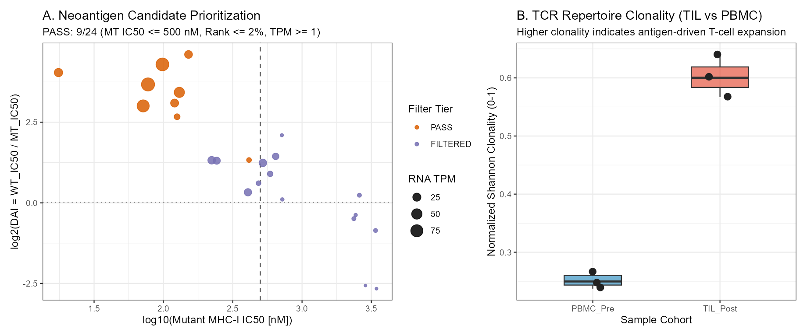
> **图注（00_smoke_neoantigen_tcr_qc.png）**：Panel A 验证多维过滤象限（`MT_IC50 <= 500 nM` 竖虚线与 `DAI = 1` 横点线左上区域集中了 9 个 `PASS` 候选）；Panel B 验证肿瘤浸润淋巴细胞（`TIL_Post`）呈现明显高于外周血基线（`PBMC_Pre`）的寡克隆扩增趋势。

---

### 5.2 阶段 2：Track A —— `scverse/scirpy`（`wu2020_3k` 3,000 细胞单细胞转录组 + TCR 组库）

- **核心定量战果**（[01_scirpy_wu2020_summary.tsv](./repro_results/scirpy_wu2020/01_scirpy_wu2020_summary.tsv)）：原始 `3,000` 细胞 × `30,727` 基因 → 剔除 `multichain = 17`、`orphan = 1,138`（含额外链比例 `0.0693`）→ 质控保留 **`1,845`** 个完整配对细胞 → 定义 **`1,526`** 个唯一核苷酸克隆型与 **`1,490`** 个氨基酸 `tcrdist` 相似簇 → 检出 **`174`** 个趋同重组（Convergent）TCR 细胞；`CD8_Teff` vs `CD8_Trm` 克隆不平衡明细见 [01_scirpy_cd8_teff_vs_trm_imbalance.tsv](./repro_results/scirpy_wu2020/01_scirpy_cd8_teff_vs_trm_imbalance.tsv)（如克隆 `68`、`101`、`127` 呈显著倾斜，`p < 0.003`）。

| 图号与文件名 | 核心视觉结果与生物学解读 |
|---|---|
| 图 1 · [01_scirpy_gex_umap_overview.png](./repro_results/scirpy_wu2020/01_scirpy_gex_umap_overview.png) | 转录组 UMAP 按 `31` 个样本、组织来源（`Blood` / `NAT` / `Tumor`）与 10 个标准化 T 细胞亚群（`CD8_Teff`、`CD8_Tem`、`CD8_Trm`、`CD4_Treg` 等）清晰分离。 |
| 图 2 · [02_scirpy_chain_qc.png](./repro_results/scirpy_wu2020/02_scirpy_chain_qc.png) | 链配对质控柱状图：绝大多数有效细胞为 `TRA+TRB` `single pair`（>1,600 细胞），其余主要为单链缺失（`orphan VDJ`/`VJ` 共 `1,138`）及少量双胞体风险多链（`multichain = 17`）。 |
| 图 3 · [03_scirpy_clonotype_network.png](./repro_results/scirpy_wu2020/03_scirpy_clonotype_network.png) | 基于 `tcrdist <= 15` 的克隆网络拓扑：可见 `159`、`68`、`10`、`169`、`157` 等大型跨组织共享克隆簇连接 `Tumor`（绿）与 `NAT`/`Blood`（橙/蓝）T 细胞。 |
| 图 4 · [04_scirpy_clonal_expansion_and_diversity.png](./repro_results/scirpy_wu2020/04_scirpy_clonal_expansion_and_diversity.png) | **`CD8_Teff`、`CD8_Tem` 与 `CD8_Trm` 具有最高的 `>2` 细胞扩增比例**（`CD8_Teff` 超 40% 属于高度扩增克隆），同时 `CD8_Teff` 归一化香农熵最低，印证抗原驱动克隆聚焦；`CD4_TCF7`/`CD4_RPL32` 则接近均一多样性。 |
| 图 5 · [05_scirpy_repertoire_overlap.png](./repro_results/scirpy_wu2020/05_scirpy_repertoire_overlap.png) | `31` 个样本两两 Jaccard 重叠聚类热图：同患者内（如 `Renal1`、`Renal2`、`Lung1`）的 `Tumor`/`NAT`/`Blood` 存在显著共享克隆对角块，跨患者几乎为零，符合个体特异性 TCR 生物学规律。 |
| 图 6 · [06_scirpy_clonotype_modularity.png](./repro_results/scirpy_wu2020/06_scirpy_clonotype_modularity.png) | 克隆簇转录组聚集模块度：克隆簇 `68`、`101`、`159` 的 modularity score > 4 且 `-log10(FDR) > 30`，表明同一 TCR 克隆细胞稳定锁定在特定功能转录状态中。 |
| 图 7 · [07_scirpy_expansion_and_antigen_umap.png](./repro_results/scirpy_wu2020/07_scirpy_expansion_and_antigen_umap.png) | 左图显示扩增克隆主要富集在左侧 `CD8_Teff`/`CD8_Trm` 区域；右图（`iggytop` 远程库不可达降级后）展示 **`174` 个趋同重组 TCR 细胞**在效应/记忆 CD8 区的分布特征。 |

<details>
<summary>点击展开查看 Track A 全部 7 张实跑结果图</summary>

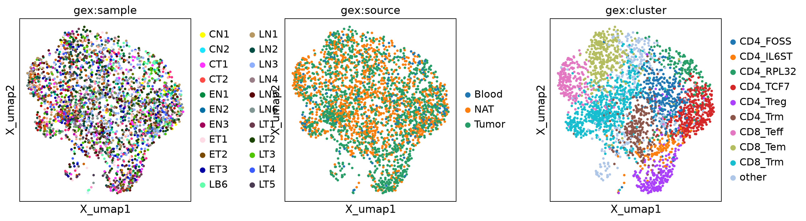
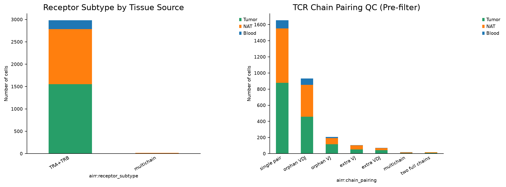
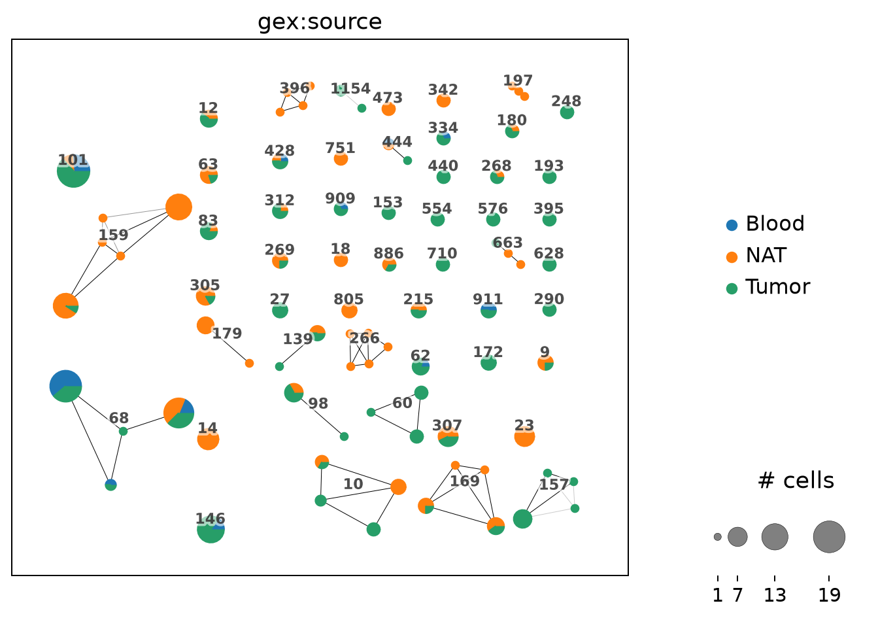
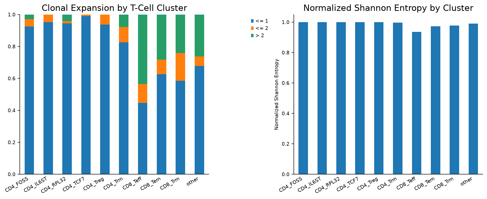
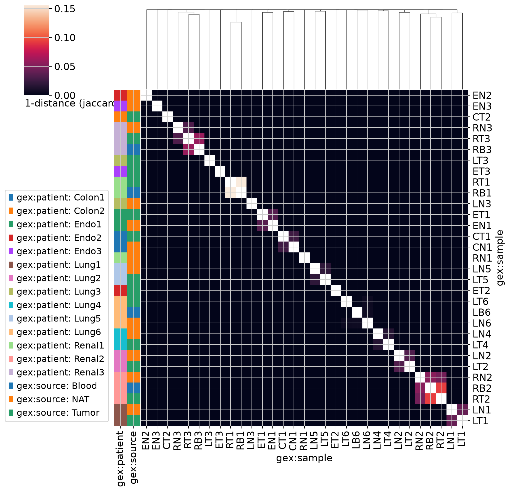
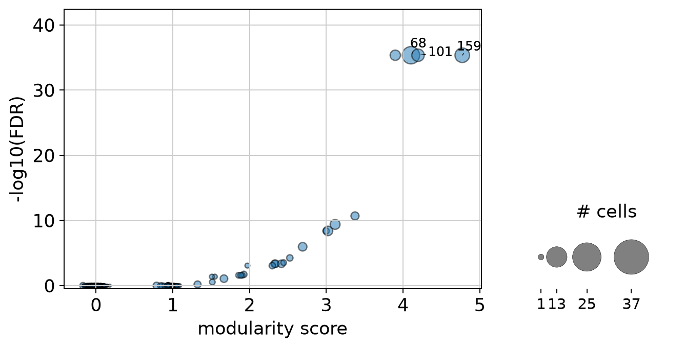
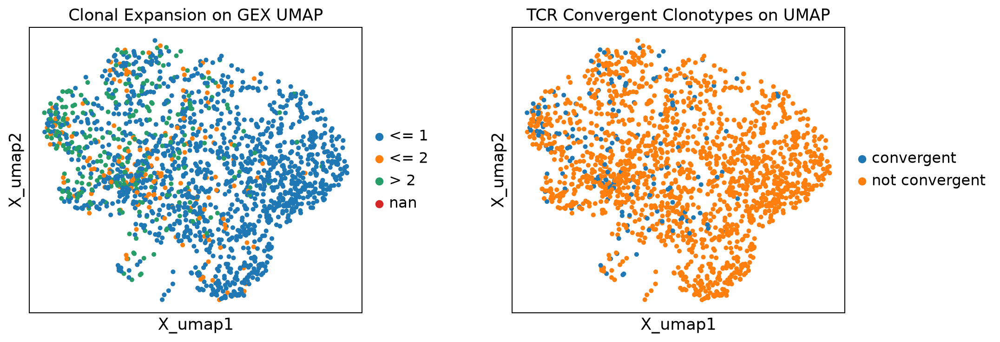

</details>

---

### 5.3 阶段 3：Track B —— `griffithlab/pVACtools`（`HCC1395` SNV/Indel + 基因融合新抗原预测）

#### Track B-1：`pvacseq` 体细胞 SNV/Indel 新抗原（[02_pvacseq_hcc1395_summary.tsv](./repro_results/pvacseq_hcc1395/02_pvacseq_hcc1395_summary.tsv) · [Top 30 候选](./repro_results/pvacseq_hcc1395/02_pvacseq_top_candidates.tsv)）
- **定量指标**：从 `1,470` 个配对体细胞变异中汇总评估 **`357`** 个有效变异，检出 **`20`** 条顺式相邻定相变异，最终筛出 **`48`** 个临床 `Tier Pass` 变异（`7` 个 `Subclonal`）与 **`52`** 条联合过滤表位（`MHC-I: 44`、`MHC-II: 17`，`6` 条位于关注基因列表）；`Pass` 变异最佳突变体 `IC50` 中位数 **`65.28 nM`**，中位 **`DAI = 1.999`**。
- **高价值候选**：`FARP1 (R714L)` `IC50 = 5.65 nM` (`HLA-C*06:02`)、`ADPRHL1 (H220N)` `6.68 nM` (`HLA-B*45:01`)、`MYBBP1A (E653G)` `9.85 nM` (`DRB1*04:05`)、`DDX3X (R294T)` `16.87 nM`（高表达 `Allele_Expr = 158.635`）、`ADAR (E806V)` `IC50_MT = 35.76 nM` vs `WT = 5006.82 nM`（`DAI = 140.012`）。

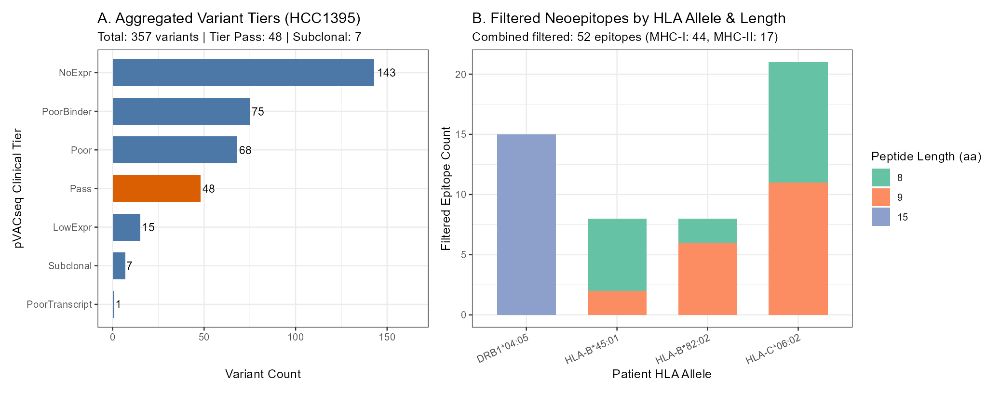
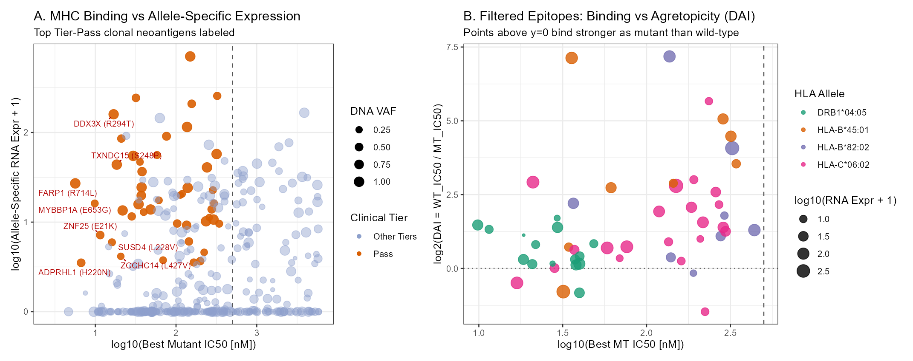

#### Track B-2：`pvacfuse` 基因融合新抗原（[03_pvacfuse_hcc1395_summary.tsv](./repro_results/pvacfuse_hcc1395/03_pvacfuse_hcc1395_summary.tsv) · [融合候选全表](./repro_results/pvacfuse_hcc1395/03_pvacfuse_top_candidates.tsv)）
- **定量指标**：联合 `AGFusion`（20 个融合目录）与 `STAR-Fusion` 读数/表达支持，共评估 **`31`** 条融合转录本异构体（涉及 `5` 个融合基因），筛选出 **`16`** 条 `Tier Pass` 异构体（**`3`** 个融合基因）与 **`14`** 条联合过滤融合新抗原表位（`MHC-I: 14`、`MHC-II: 6`），`Pass` 异构体最佳 `IC50` 中位数 **`10.96 nM`**。
- **高价值融合候选**：`TMEM104_RAB37`（`YRIYLTIL`, `HLA-C*06:02`, `5.15 nM`, `Read Support = 46`, `FFPM = 0.124`）、`EIF3K_CYP39A1`（`AEMLGDLSA`, `HLA-B*45:01`, `16.76 nM`, `Read Support = 239`, `FFPM = 0.643` 及其移码异构体 `FWHQFQRM`, `24.93 nM`）、`HNRNPUL2_AHNAK`（`NPGAAAAQL`, `HLA-B*82:02`, `440.62 nM`, `Read Support = 58`）。

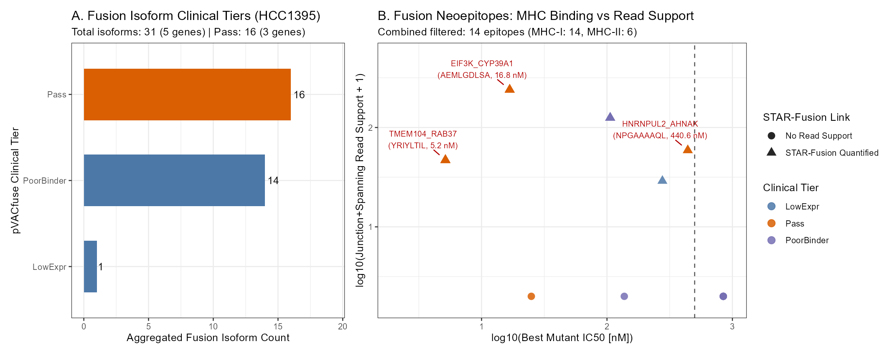

---

## 6. 一键构建与复现命令

```powershell
# 0. 运行前环境体检与 REPRO-D 冒烟自检（含宿主机版本采集与断言校验）
powershell -ExecutionPolicy Bypass -File reproduction/neoantigen_immunogenomics/envs/nextflow_docker_check.ps1
python reproduction/neoantigen_immunogenomics/repro_scripts/run_all.py --mode smoke

# 1. 构建两个物理隔离 Docker 镜像（仅首次需要）
docker build -f reproduction/neoantigen_immunogenomics/envs/Dockerfile.scirpy -t neoantigen-scirpy:py313 reproduction/neoantigen_immunogenomics
docker build -f reproduction/neoantigen_immunogenomics/envs/Dockerfile.pvactools -t neoantigen-pvactools:7.1.5 reproduction/neoantigen_immunogenomics

# 2. 按需运行单轨或全流程（均由 run_all.py 统一调度并自动检验输出完整）
python reproduction/neoantigen_immunogenomics/repro_scripts/run_all.py --mode track-a
python reproduction/neoantigen_immunogenomics/repro_scripts/run_all.py --mode track-b
python reproduction/neoantigen_immunogenomics/repro_scripts/run_all.py --mode downstream
# 或端到端重跑全部轨道：
# python reproduction/neoantigen_immunogenomics/repro_scripts/run_all.py --mode all

# 3. 检查 R 依赖包（支持 --dry-run）
Rscript reproduction/neoantigen_immunogenomics/envs/install_packages.R --dry-run
```

---

## 7. 工程文档与后续拓展 Roadmap

### 已沉淀工程文档与数据清单
- **技术 SOP 与新队列接入指南**：[REPRO_E_双轨复现SOP与排坑复盘.md](./docs/REPRO_E_双轨复现SOP与排坑复盘.md)
- **三级数据台账**：[data/README.md](./data/README.md) ｜ [data/raw/README.md](./data/raw/README.md) ｜ [data/processed/README.md](./data/processed/README.md)

### 可拓展延伸方向（供后续迭代）
1. **`pVACview` 本地交互审阅启动**：当前已在 `data/processed/pvacseq_hcc1395/combined/` 与 `pvacfuse_hcc1395/combined/` 自动生成 Shiny 工程代码，可在本地或 Shiny 容器内执行 `shiny::runApp(...)` 交互式人工复核锚定位点与免疫原性列。
2. **多维新抗原理化打分整合（`TRON-Bioinformatics/neofox`）**：对本流程导出的 `Tier Pass` 候选肽进一步补充 Self-Similarity、PHBR 与疏水稳定性打分。
3. **公共癌基因组与免疫库交叉注释**：结合 `COSMIC` / `DepMap`（评估靶基因是否属于肿瘤必需/驱动基因以降低抗原丢失逃逸风险）及本地离线化 `VDJdb` / `iggytop` 完成“靶向新抗原—反应性 TCR”闭环。
4. **集群生产编排升级（`nf-core/epitopeprediction` Nextflow DSL2）**：在 Ubuntu WSL2 或 Linux Slurm HPC 上切换为 Singularity/Apptainer + Nextflow DSL2 多样本并行调度。
