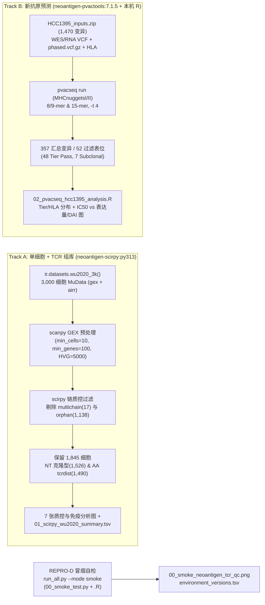

# `REPRO-E` 双轨肿瘤新抗原与单细胞 TCR 复现技术 SOP 与排坑复盘

> **文档性质**：严格遵循 [01_生信复现项目检索与审计提示词.md](../../01_生信复现项目检索与审计提示词.md) `REPRO-E` 规范沉淀的工程技术复盘文档。所有参数、软件包版本、日志报错与定量结果均来自本工作区容器与 R 脚本实测输出。

---

## 1. 项目背景与双轨架构流转

为完整覆盖肿瘤新抗原（Neoantigen）疫苗 / TCR-T 生信研发的两端核心能力，本工作区采用 **“上游体细胞新抗原预测（Track B）+ 下游单细胞转录组/TCR 克隆免疫组库（Track A）”** 双轨并行架构，并通过统一冒烟流水线与隔离 Docker 容器保障跨机器可复现性：



### 环境物理隔离设计（零交叉污染）

- **与同仓其他项目隔离**：宿主机与同仓库 `scan-dig/` `.venv` 完全不共享依赖；Docker 容器通过 `-v "${ProjRoot}:/workspace"` 仅挂载 [neoantigen_immunogenomics/](../) 目录。
- **双镜像分层设计**：
  - Track A 镜像 `neoantigen-scirpy:py313`（[Dockerfile.scirpy](../envs/Dockerfile.scirpy)，镜像大小 `2.17GB`）：`python 3.13.18` + `scirpy 0.26.1` + `scanpy 1.13.0` + `muon 0.2.1` + `mudata 0.4.1` + `parasail 1.3.4` + `leidenalg 0.12.0`（完整版本见 [scirpy_container_versions.tsv](../repro_results/scirpy_wu2020/scirpy_container_versions.tsv)）。
  - Track B 镜像 `neoantigen-pvactools:7.1.5`（[Dockerfile.pvactools](../envs/Dockerfile.pvactools)，镜像大小 `5GB`，相较官方含 IEDB/NetMHCpan 的 `9.02 GB` 压缩镜像大幅精简且免商用/学术授权）：锁定 `python 3.11.18` + `pvactools 7.1.5` + `mhcnuggets 2.4.1` + `tensorflow 2.15.1` + `numpy 1.26.4` + `pyarrow 18.1.0` + `polars 0.16.18`（完整版本见 [pvactools_container_versions.tsv](../repro_results/pvacseq_hcc1395/pvactools_container_versions.tsv)）。
- **下游统计绘图**：宿主机 `R 4.6.0`（`data.table`、`ggplot2`、`patchwork`、`ggrepel`）。

---

## 2. 端到端一键复现 SOP（Windows PowerShell + Docker Desktop）

在仓库根目录 `d:\project\gemini` 下按以下顺序执行即可完整重现全部流程与图表：

```powershell
# Step 0: 运行前环境体检与最小冒烟测试（验证 Python/R/Docker 就绪）
powershell -ExecutionPolicy Bypass -File reproduction/neoantigen_immunogenomics/envs/nextflow_docker_check.ps1
python reproduction/neoantigen_immunogenomics/repro_scripts/run_all.py --mode smoke

# Step 1: 构建 Track A 容器镜像并运行 scirpy wu2020_3k 全流程
docker build -f reproduction/neoantigen_immunogenomics/envs/Dockerfile.scirpy -t neoantigen-scirpy:py313 reproduction/neoantigen_immunogenomics
$AbsRoot = (Resolve-Path "reproduction/neoantigen_immunogenomics").Path
docker run --rm -v "${AbsRoot}:/workspace" -w /workspace neoantigen-scirpy:py313 `
  python /workspace/repro_scripts/01_scirpy_wu2020_tcr.py

# Step 2: 构建 Track B 轻量化 pVACtools 镜像并执行 HCC1395 全量预测 + R 优先级分析
docker build -f reproduction/neoantigen_immunogenomics/envs/Dockerfile.pvactools -t neoantigen-pvactools:7.1.5 reproduction/neoantigen_immunogenomics
powershell -ExecutionPolicy Bypass -File reproduction/neoantigen_immunogenomics/repro_scripts/02_run_pvacseq_hcc1395.ps1
```

> **快速校验位点**：
> - `logs/smoke_run.log` 与 `repro_results/00_smoke_verification_summary.tsv`（`Smoke_Status = PASS`）；
> - `logs/01_scirpy_wu2020.log` 与 `repro_results/scirpy_wu2020/01_scirpy_wu2020_summary.tsv`；
> - `logs/02_pvacseq_hcc1395.log` 与 `repro_results/pvacseq_hcc1395/02_pvacseq_hcc1395_summary.tsv`。

---

## 3. 核心质控阈值、统计假设与实测定量基准

### Track A（`scverse/scirpy` `wu2020_3k`：肺癌肿瘤/外周血/癌旁 T 细胞）

| 处理环节 | 脚本关键阈值 / 方法 | 实测保留量 / 统计结果 |
|---|---|---|
| 原始输入加载 | `ir.datasets.wu2020_3k()`（`SEED = 20261115`） | `3,000` 细胞 × `30,727` 基因（GEX） + `3,000` 细胞（AIRR） |
| GEX 预处理 | `min_cells=10`、`min_genes=100`、`normalize_total`、`log1p`、`HVG n_top_genes=5000`、`n_pcs=50` | 过滤 `18,877` 个低检出基因，保留 `11,850` 个基因并复用/计算 UMAP |
| TCR 链配对 QC | `ir.pp.index_chains` + `ir.tl.chain_qc`；剔除 `multichain` 与 `orphan VDJ/VJ` | `multichain = 17`，`orphan = 1,138`（含额外链比例 `0.0693`），质控后保留 **`1,845`** 个配对细胞 |
| 克隆型与相似簇 | 核苷酸完全一致（`receptor_arms="all", dual_ir="primary_only"`）；氨基酸 `tcrdist`（`cutoff=15, dual_ir="any"`） | **`1,526`** 个唯一 NT 克隆型；**`1,490`** 个 AA `tcrdist` 聚类簇 |
| 克隆收敛与功能不平衡 | `ir.tl.clonotype_convergence`；`clonotype_imbalance`（`CD8_Teff` vs `CD8_Trm`，跨 `31` 个样本） | **`174`** 个收敛型 TCR 细胞；已输出全部 `1,522` 条克隆型不平衡检验表（[01_scirpy_cd8_teff_vs_trm_imbalance.tsv](../repro_results/scirpy_wu2020/01_scirpy_cd8_teff_vs_trm_imbalance.tsv)） |

### Track B（`griffithlab/pVACtools v7.1.5` `HCC1395` 乳腺癌细胞系配对样本）

| 处理环节 | 核心命令与筛选逻辑 | 实测定量基准 |
|---|---|---|
| HLA 与表位空间 | 输入 5 个等位基因：`HLA-A*29:02,HLA-B*45:01,HLA-B*82:02,HLA-C*06:02,DRB1*04:05`；`MHCnuggetsI`（8/9-mer）+ `MHCnuggetsII`（15-mer） | 原始 VCF `1,470` 个变异；结合 `-phased-proximal-variants-vcf` 识别 `20` 条顺式相邻定相变异记录 |
| 临床分级与克隆性 | `pvacseq` 基于 Tumor DNA VAF 估算主克隆 VAF 为 `0.5`（低于 `0.25` 判为 `Subclonal`），并综合结合力、表达量与转录本支持度划分 `Tier` | 汇总评估 **`357`** 个编码突变；其中 **`48`** 个为 **`Tier Pass`**，**`7`** 个为 `Subclonal` |
| 联合过滤表位 | 通过 `pvacseq` Binding、Coverage、TSL 与 Top Score 联合过滤（MHC-I≤500 nM / MHC-II 对应阈值及覆盖度门槛） | **`52`** 条联合过滤候选新抗原表位（`MHC-I: 44` 条，`MHC-II: 17` 条；其中 `6` 条位于关注基因列表） |
| 亲和力与差异免疫原性 | 下游 R 计算 `DAI = IC50_WT / IC50_MT`（衡量突变相对野生型的结合增强倍数） | `Tier Pass` 变异最佳突变体 `IC50` 中位数 **`65.28 nM`**，**`DAI` 中位数 `1.999`** |

---

## 4. 复现过程中定位并解决的真实工程问题

以下是本次落地过程中实际遭遇并经日志/代码验证修复的 5 个典型工程问题（已全部固化进 Dockerfile 与脚本）：

1. **`pvactools 7.1.5` 与新版科学计算/箭头库二进制冲突（ABI 锁死）**
   - **现象**：直接 `pip install pvactools==7.1.5` 时，`pyarrow`（>=19）与 `tensorflow`（>=2.18）默认拉取 `numpy>=2.0`，与 `pvactools==7.1.5` 强要求的 `numpy==1.26.4` 冲突报错。
   - **修复**：参考上游 CI 配置，在 [Dockerfile.pvactools](../envs/Dockerfile.pvactools) 中显式钉扎 `"numpy==1.26.4" "pyarrow<19" "polars==0.16.18" "tensorflow<2.16" "pvactools==7.1.5"`（实测解析为 `pyarrow 18.1.0` + `tensorflow 2.15.1`）。
2. **容器网络对 `release-assets.githubusercontent.com` 的连接拒绝（影响模型与公共库下载）**
   - **现象**：在 Docker 构建期执行 `mhcflurry-downloads fetch` 以及 Track A 运行期调用 `ir.datasets.iggytop()` 时，均触发 `ConnectionError / Connection refused`（指向 `release-assets.githubusercontent.com:443`）。
   - **修复**：
     - **Track B**：移除在线 `mhcflurry-downloads` 步骤，改用安装包自带本地权重的 `MHCnuggetsI` 与 `MHCnuggetsII`，并先用 `pvactools valid_alleles` 确认 `HCC1395` 全部 5 个 HLA-I/II 等位基因受支持，实现完全离线推理；
     - **Track A**：在 [01_scirpy_wu2020_tcr.py](../repro_scripts/01_scirpy_wu2020_tcr.py#L228-L270) 中对 `iggytop` 网络查询增加异常处理与降级分支，远程不可达时自动跳过并输出 `clonal_expansion` + `is_convergent` 双联 UMAP 闭环图，保证流水线稳健退出 `0`。
3. **`python:3.11-slim` 运行 `pvacseq` 时缺失隐式 Tk 动态库**
   - **现象**：`pvactools.lib.vector_visualization` 导入 Python 标准库 `turtle`/`tkinter`，精简镜像缺少 `libtk8.6.so` 导致 `ImportError`。
   - **修复**：在 [Dockerfile.pvactools](../envs/Dockerfile.pvactools#L31-L33) 补充 `libtk8.6` 运行时包。
4. **`scanpy 1.13.0` API 弃用移除导致的兼容问题**
   - **现象**：原版旧教程常用 `sc.pp.normalize_per_cell()` 在新版本中已被移除。
   - **修复**：在 [01_scirpy_wu2020_tcr.py](../repro_scripts/01_scirpy_wu2020_tcr.py#L91-L92) 统一迁移至 `sc.pp.normalize_total()`，并保留确定性 `random_state=20261115`。
5. **强结合新抗原在发表级散点图左边界出现文字标签截断**
   - **现象**：初版 `02_pvacseq_ic50_vs_expression_and_dai.png` 图 A 中，最左侧高亲和力基因 `FARP1 (R714L)`（`IC50 = 5.65 nM`）与 `ADPRHL1 (H220N)`（`IC50 = 6.68 nM`）标签越过左轴边缘被截断。
   - **修复**：在 [02_pvacseq_hcc1395_analysis.R](../repro_scripts/02_pvacseq_hcc1395_analysis.R#L148-L170) 中引入 `ggrepel::geom_text_repel`（并附带 `check_overlap = TRUE` 回退保护）配合 `scale_x_continuous(expand = expansion(mult = c(0.14, 0.06)))`，重绘并人工视觉核查确认所有标签零截断、零遮挡。

---

## 5. 复用指南：切换为新一批真实临床肿瘤样本时如何接入

若需将本双轨骨架直接用于公司/实验室的新一批肿瘤队列样本（非公开测试集），只需按下列契约准备输入并修改传参：

### 接入 Track B（配对 WES + RNA-Seq 新抗原预测）
1. **前置注释（必须在 `pvacseq run` 前完成）**：
   - 使用 Ensembl VEP（`--pick` 或全转录本 + `Frameshift` + `Wildtype` 插件）注释体细胞 VCF，确保 `INFO/CSQ` 字段包含蛋白序列变化与转录本支持度（TSL）；
   - 使用 `vatools`（`vcf-expression-annotator` / `vcf-readcount-annotator`）将 RNA-Seq 基因/转录本 TPM（`GX`/`TX`）与 RNA-Seq 等位基因深度/VAF（`RAD`/`RAF`）写入肿瘤样本列（FORMAT）；
   - 使用 `OptiType`（MHC-I）和 `HLA-HD` / `arCasHLA`（MHC-II）获得患者 4-digit 高分辨 HLA 分型。
2. **顺式定相（Phased Proximal Variants）**：
   - 强烈建议提供经 `Whatshap` 或 `GATK ReadBackedPhasing` 生成的 `--phased-proximal-variants-vcf`（同时包含体细胞与胚系杂合 SNP 并已 `tabix` 建索引），避免顺式连锁多态位点造成野生型/突变型长肽翻译失真（本次 `HCC1395` 即据此校正了 `20` 条邻近变异）。
3. **参数替换位置**：
   - 复制 [02_run_pvacseq_hcc1395.ps1](../repro_scripts/02_run_pvacseq_hcc1395.ps1)，将输入 VCF 路径、肿瘤/正常样本名（需与 VCF Header `#CHROM` 样本列名严格一致）、HLA 等位基因串、输出目录以及 [02_pvacseq_hcc1395_analysis.R](../repro_scripts/02_pvacseq_hcc1395_analysis.R) 的文件前缀替换为新队列样本编号即可；若有校内/企业 IEDB 授权或本地 `mhcflurry` 离线权重挂载，可在预测算法列表追加 `NetMHCpan` / `MHCflurry` 进行多算法集成取中位 IC50。

### 接入 Track A（10x Genomics 5' scRNA-seq + V(D)J TCR）
1. **输入对齐**：将 `ir.datasets.wu2020_3k()` 替换为 `scanpy.read_10x_mtx` / `read_10x_h5` 读取表达矩阵，并用 `ir.io.read_10x_vdj("filtered_contig_annotations.csv")` 构造 `MuData({"gex": adata, "airr": adata_tcr})`；
2. **细胞聚类注释字典调整**：更新 `cluster_orig -> cluster` 映射（或直接使用 Leiden + 经典 Marker `CD3D/CD8A/CD4/FOXP3/GZMB/PDCD1/TCF7/ZNF683` 注释亚群），随后直接复用 `index_chains -> chain_qc -> ir_dist -> define_clonotypes -> clonal_expansion -> repertoire_overlap` 标准流水线；
3. **公共抗原库内网镜像**：若处于受限内网环境，可预先在联网跳板机缓存 `iggytop` / `vdjdb` Parquet/H5AD 字典至 `data/raw/scirpy_cache/`，通过本地路径传参给 `ir.pp.ir_dist` 进行离线 TCR-抗原表位匹配。
